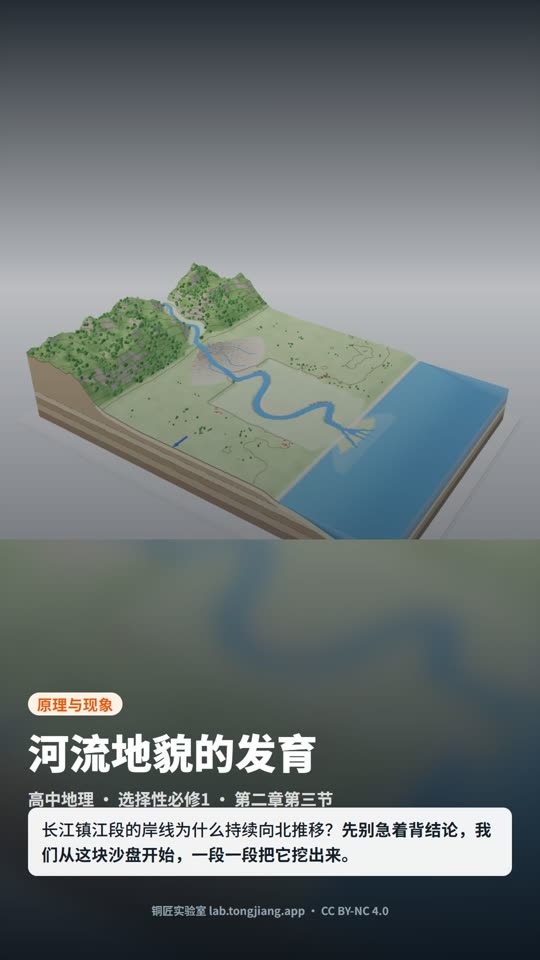
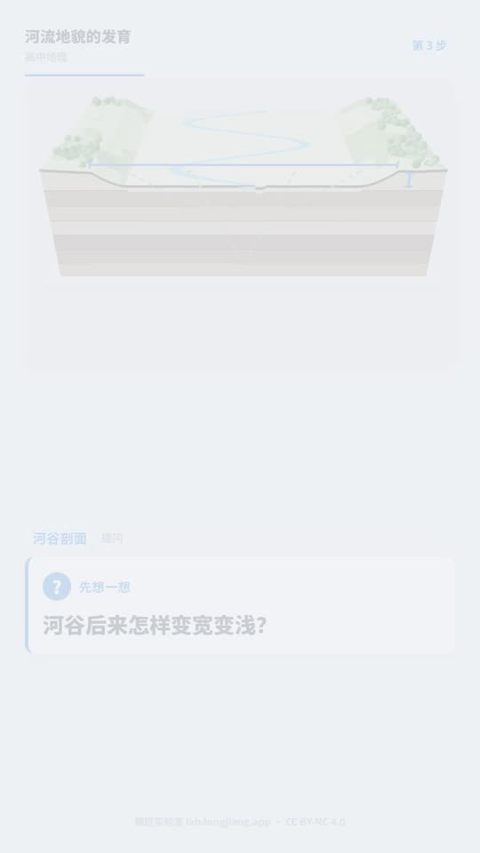
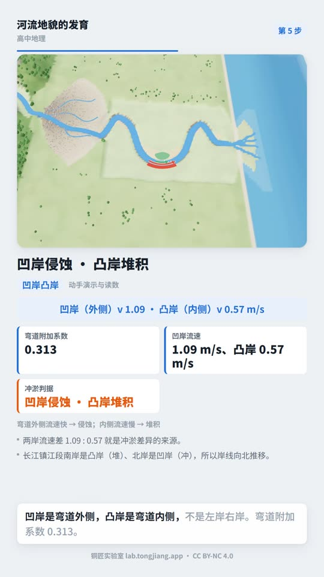
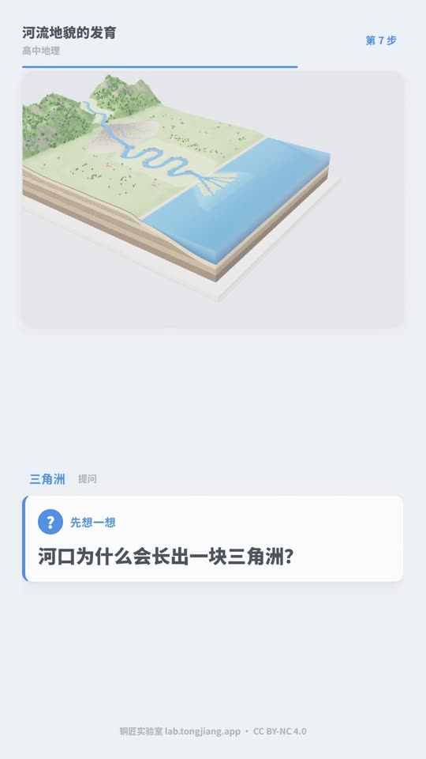
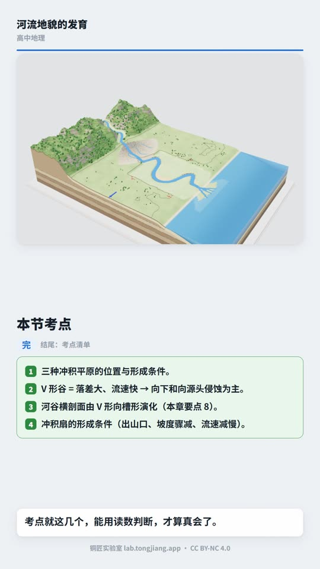

# courseware-to-video

**把一个做好的 3D 交互课件，自动变成一条竖屏讲解短视频。**

给一个课件 HTML，脚本自己去读课件里写好的教案、去抓课件自己的 3D 画面、
去配中文旁白，最后合成一条 1080×1920 的成片。

> 不重新画动画、不重写讲稿 —— **画面和内容都来自课件本身**，
> 脚本只负责把它们排成一条能发的短视频。

---

## 样片

用「河流地貌的发育」课件（铜匠实验室）跑出来的成片：**89 秒 / 19 镜 / 1080×1920**。



<p align="center">
  
  
  
  
</p>

| 开场悬念 | 提问 | 答案 + 读数 | 考点清单 |
|---|---|---|---|

📹 完整成片：[`examples/river-step/样片-河流地貌的发育.mp4`](examples/river-step/样片-河流地貌的发育.mp4)
📝 逐拍讲稿：[`examples/river-step/讲稿-河流地貌的发育.md`](examples/river-step/讲稿-河流地貌的发育.md)

---

## 为什么这么做

面对一个交互课件，最省力也最忠实的短视频做法是**不重新创作**：

| 常规做法 | 本项目做法 |
|---|---|
| 看课件 → 自己写讲稿 → 自己找配图 → 自己配字幕 | 课件里已经写好了提问、演示、读数、结论、考点 → **直接抽出来** |
| 用录屏软件录操作过程，字幕后期手工加 | 无头浏览器按讲稿一步步操作课件 → **自动抓静帧和运动片段** |
| 视频和旁白对不上，得一帧帧卡 | 镜头时长 = 音频真实时长 → **天然同步** |

所以成片里出现的每一个数字，都能回到课件原文核对。

---

## 快速开始

### 1. 准备环境

需要 **Node ≥ 20**、**Python ≥ 3.10**、**Chrome**、**ffmpeg**。

```bash
git clone https://github.com/liangdabiao/courseware-to-video.git
cd courseware-to-video

# Python 依赖
pip install edge-tts

# Remotion 依赖（第一次要装，约 300MB）
cd templates/remotion-project && npm install && cd ../..
```

### 2. 确认课件支持

课件必须暴露 `window.__lab` 运行时 API（铜匠实验室全系 54 个课件都符合）。

```bash
node scripts/extract_course.mjs /path/to/课件.html --out course.json
```

如果报 `window.__lab 未就绪`，说明这个课件不是本工具支持的类型 —— **停下来问，别硬猜**。

### 3. 一键跑完

```bash
bash scripts/run_ep.sh /path/to/课件.html river-step
```

产物在 `_work/river-step/build/river-step/out/course.mp4`。

---

## 手动分步跑

```bash
# 1) 抽教案 → course.json
node scripts/extract_course.mjs 课件.html --out course.json

# 2) 排镜头 + 写讲稿 → script.json / 讲稿.md
python scripts/plan_shots.py --course course.json --out script.json \
       --script-md 讲稿.md --profile core

# 3) 抓 3D 画面 → media/*.png（静帧）、media/*.mp4（运动片段）
node scripts/capture_3d.mjs --script script.json --out media \
       --width 1200 --height 800 --html 课件.html

# 4) 合成中文旁白 → audio/*.mp3
python scripts/gen_tts.py script.json --out audio --voice zh-CN-XiaoyiNeural

# 5) 回填时间轴（按音频真实时长）
python scripts/apply_timeline.py script.json --audio audio --media media

# 6) 组装 Remotion 工程并渲染
python scripts/build_project.py --script script.json --project build/river-step
cd build/river-step
npx remotion render src/index.ts CourseVideo out/course.mp4 \
    --codec=h264 --crf=18 --pixel-format=yuv420p --concurrency=1

# 7) 体检（不能省）
python scripts/verify_media.py build/river-step/out/course.mp4
```

---

## 改成自己的旁白

`plan_shots.py` 生成的讲稿是机器写的，肯定不如人手调好。
改 `overrides.json` 就行：

```json
{
  "narration": {
    "s05": "这里换成你自己写的旁白。",
    "s07": "这条也要改。"
  }
}
```

然后重跑第 4~6 步：

```bash
python scripts/gen_tts.py script.json --out audio --overrides overrides.json --force
python scripts/apply_timeline.py script.json --audio audio --media media
python scripts/build_project.py --script script.json --project build/river-step
cd build/river-step && npx remotion render src/index.ts CourseVideo out/course.mp4 \
    --codec=h264 --crf=18 --pixel-format=yuv420p --concurrency=1
```

---

## 目录结构

```
courseware-to-video/
├── SKILL.md                      # skill 说明（给 AI 读的）
├── README.md                     # 本文件（给人读的）
├── scripts/
│   ├── lib_cdp.mjs               # CDP 客户端：直连 Chrome，不依赖 puppeteer
│   ├── extract_course.mjs        # 抽教案 → course.json
│   ├── plan_shots.py             # 排镜头 + 写讲稿 → script.json
│   ├── capture_3d.mjs           # 抓 3D 画面 → media/
│   ├── gen_tts.py                # 中文旁白 → audio/
│   ├── apply_timeline.py         # 按音频时长回填时间轴
│   ├── build_project.py          # 组装 Remotion 工程
│   ├── verify_media.py           # 成片体检（时长 / 波形 / 媒体结构）
│   └── run_ep.sh                 # 一键跑完
├── templates/remotion-project/   # Remotion 4.0.487 模板（竖屏 1080×1920@30fps）
│   └── src/
│       ├── Scene.tsx             # 五种版式：title/ask/answer/chain/end
│       ├── ui.tsx                # 字幕条、数据卡、公式条、要点、徽章
│       ├── theme.ts              # 配色与字号
│       ├── CourseVideo.tsx       # 镜头编排 + 音轨
│       ├── Root.tsx / index.ts   # 入口
│       ├── script.ts / types.ts  # 时间轴计算与类型
├── references/
│   ├── courseware-api.md         # window.__lab API 全表
│   └── pipeline.md               # 流水线详解 + 踩坑记录
└── examples/river-step/          # 样片（成片 + 讲稿 + 截图）
```

---

## 支持的课件类型

课件需要暴露 `window.__lab`，核心 API：

| 能力 | API |
|---|---|
| 步骤总数 | `__lab.STEPS.length` |
| 步骤内容 | `__lab.STEPS[i]` → `{q, act, expect, points, concl, exam, eq}` |
| 跳到第 N 步 | `__lab.goto(i, {instant: true})` |
| 改参数 | `__lab.set(k, v)` / `__lab.toggle(k)` / `__lab.setSwitch(k, v)` |
| 读当前状态 | `__lab.live()` |
| 重放作者演示 | `__lab.STEPS[i].act.demo(__lab.ctx)` |
| 相机 | `__lab.camera` / `__lab.controls` / `__lab.camCfg` |

> ⚠️ `act.demo` **必须传 `__lab.ctx`**，直接传数字会报 undefined。

完整说明见 [`references/courseware-api.md`](references/courseware-api.md)。

---

## 成片长什么样

竖屏 1080×1920 @ 30fps，五种版式：

| 版式 | 什么时候用 | 长什么样 |
|---|---|---|
| `title` | 开场 | 整幅 3D 画面 + 暗色蒙版 + 大标题 + 悬念提问 |
| `ask` | 每一步开头 | 3D 画面 + 巨大的提问卡（先问再答） |
| `answer` | 回答 | 3D 画面 + 数据卡（真实读数）+ 公式条 + 要点 |
| `chain` | 收尾 | 因果链回扣开头的问题 |
| `end` | 结尾 | 本节考点清单 + 署名 |

字幕条用「渐进高亮」：当前句加深、后面的淡化，条高恒定不跳版。

---

## 常见问题

| 症状 | 原因 | 怎么办 |
|---|---|---|
| 画面飘到底部 / 被裁 | 非 16:9 画幅下相机 target.y 算错 | 先在原生 16:9 记录相机，再按比例重建（脚本已做） |
| 图表漏进画面右下角 | 放行了所有 canvas | 只放开 three.js 的 `renderer.domElement` |
| 主体撑满 99% | 固定亮度阈值把灰色背景当成了内容 | 四边条带中位数估背景 + 色差判 ink |
| 主体溢出画幅 | 自动取景只看宽度 | 宽高都算，取较小的放大倍数 |
| 抓帧极慢 / 掉帧 | 没开 GPU 加速 | 必须 `--use-angle=d3d11`（软件渲染只有 2.6fps） |
| TTS 偶发 0 字节 | edge-tts 网络抖动 | 脚本自动重试 3 次，<1KB 视为失败重做 |
| 话没说完画面就切走 | 镜头时长是估的 | 用 `apply_timeline.py` 按音频真实时长回填 |
| 渲染很慢 / 卡死 | 并发太高 | `--concurrency=1`，一次只跑一个渲染 |

---

## 交付前必须做的体检

```bash
python scripts/verify_media.py build/<slug>/out/course.mp4
```

查三件事：媒体结构（分辨率 / 帧率 / 流）、时长与时间轴是否一致、
**音频波形**（0.5s 窗 RMS，有声窗占比 >95%，静音段都 <2s）。

> ⚠️ 音轨损坏时 `ffprobe` 的时长依然是对的，媒体校验也可能 PASS。
> **只有把波形拿出来量才抓得住**，这一步不能省。

---

## 许可与署名

- 本仓库代码：MIT。
- **课件内容归原作者**，成片必须保留课件要求的署名。
  （样片用的是铜匠实验室 CC BY-NC 4.0，署名已烧进片尾。）
- 字体：Noto Sans SC（SIL OFL），随模板附带。

---

## 参考

- [`references/courseware-api.md`](references/courseware-api.md) — `window.__lab` API 全表
- [`references/pipeline.md`](references/pipeline.md) — 流水线详解与踩坑记录
- [Remotion](https://www.remotion.dev/) — 视频合成框架
- [edge-tts](https://github.com/rany2/edge-tts) — 中文 TTS
